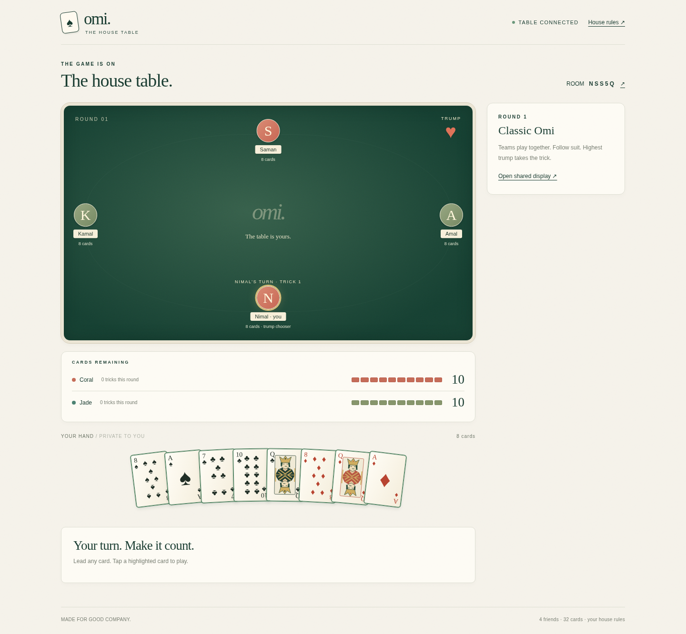

<p align="center">
  
</p>

<h1 align="center">Omi — The house table</h1>

<p align="center">Four friends. Two teams. Your house rules.</p>

<p align="center">
  <a href="https://omi-the-house-table.onrender.com/">Play Omi</a> ·
  <a href="docs/RULES.md">House rules</a> ·
  <a href="docs/DEPLOYMENT.md">Deployment & installation</a>
</p>

Omi is a private, real-time card game for roommates and friends. Play on Android, iPhone, or a laptop through the browser—or install the website on your phone’s home screen without an APK.

Built with **Node.js, Express, Socket.IO, and plain HTML/CSS/JavaScript**. No frontend build step, account registration, database, or third-party CDN is required.

## Features

- Private rooms with five-character codes, invite links, and QR codes.
- Four players in two teams; partners sit opposite each other.
- Private hands, turn indicators, and server-enforced legal moves.
- Direct and deferred trump selection.
- Household **Harf court**, **Full court**, and **Kapothi** rules.
- Personalized round results, match results, remaining-card tracks, and round history.
- Optional shared laptop display that never shows private hands.
- Android/iPhone home-screen installation as a Progressive Web App (PWA).
- Automatic reconnection after a temporary network interruption in the same browser/app window.

## Preview



*Player view from an automated test room. The optional shared display does not reveal hands.*

## Play with friends

1. Open **[the game](https://omi-the-house-table.onrender.com/)** on your phone.
2. Enter your name and create a table.
3. Share the invitation link or QR code with three friends.
4. Everyone enters a name and chooses a seat. Opposite seats are teammates: **Coral** and **Jade**.
5. Once all four players are seated and connected, the host selects **Deal the cards**.
6. Follow the turn instructions. At trick end, select **Next trick**; at round end, select **Deal next round**.

For a laptop display, use **TV view / Open shared display** in the game, or open:

```text
https://omi-the-house-table.onrender.com/?room=YOUR_CODE&display=1
```

The display does not occupy a player seat. Everyone can use the same Wi-Fi or different internet connections as long as they can reach the server.

## Install on your phone — no APK

### Android

Open the HTTPS website in **Chrome**. Tap **Install** if offered, or use **⋮ → Install app / Add to Home screen**. Launch Omi from its new icon.

### iPhone / iPad

Open the website in **Safari**, then **Share → Add to Home Screen → Add**. If shown, keep **Open as Web App** enabled.

Install **before creating a room**, then play from that home-screen window. Browser tabs and installed windows may have separate sessions.

**Multiplayer still needs a connection.** Offline mode shows a reconnect page; it does not let you play without the server. Installation availability and menu wording depend on the browser/device.

## Quick start for development

Use **Node.js 22 LTS** and npm. The project declares Node.js 20+ compatibility; Node.js 22 is the configured deployment/CI version.

```sh
git clone https://github.com/Shamika-WAD/omi-house-table.git
cd omi-house-table
npm ci
npm start
```

Open **http://localhost:3000**. There is no separate frontend command and no required `.env` file.

### Play over local Wi-Fi

Open the laptop’s LAN address on every phone—for example, `http://192.168.1.25:3000`—and allow port 3000 through the laptop’s private-network firewall. Create the room using that address so its QR code points to the reachable laptop, not `localhost`.

Use an internet-hosted **HTTPS** URL for reliable home-screen installation. Plain LAN HTTP is not generally a secure context for PWA features. See [deployment instructions](docs/DEPLOYMENT.md).

## Scoring: cards remaining

**Each team starts with 10 scoring cards. Cards owed are removed from the losing team, not added to the winners. The first team with zero cards loses.**

Example: Coral 10 / Jade 10 → Jade loses 2 → **Coral 10 / Jade 8**.

| Outcome | Cards removed |
|---|---|
| Normal round won by the trump-calling team | Losing team −1 |
| Normal round won by the opponents | Losing team −2 |
| 4–4 draw | None; draw remains pending |
| Next normal win after one or more draws | Losing team −2 |
| Harf court or Full court, success or failure | Losing team −2 |
| Kapothi succeeds | Opponents −3 |
| Kapothi fails | Declaring team −2 |

Resolved court/Kapothi results clear a pending draw. Penalties are capped at the cards remaining; balances never go negative. Read the [full household rules](docs/RULES.md) for eligibility, timing, and trump rotation.

## Tests

```sh
npm ci
npm run check
npm test
```

The **22 rules/server tests** cover legal play, private hands, draw carryover, court/Kapothi outcomes, deduction-only scoring, 100 randomized rounds, real multiplayer sockets, QR generation, and reconnect recovery. The integration test temporarily uses port **3099**.

For real-browser checks:

```sh
npx playwright install --with-deps chromium
npm run test:browser
```

This command starts its own test server on port **3190**, runs the desktop/mobile, result-dialog, and PWA checks, then stops the test server. Screenshots go to ignored `artifacts/`. You do **not** need `npm start` in another terminal. Change the test port with `OMI_TEST_PORT` if necessary.

Browser tests cover Chromium desktop/mobile viewports, QR/install assets, offline fallback, popup behavior, and a complete four-player round. They are not a substitute for physical Android/iPhone testing.

GitHub Actions runs syntax, rules/server, and browser checks on pushes and pull requests.

## Deploy

Use a **long-running Node.js web service**, not GitHub Pages or a short-lived serverless function. The same server serves the frontend and Socket.IO connection.

| Setting | Value |
|---|---|
| Build | `npm ci --omit=dev` |
| Start | `npm start` |
| Health check | `/health` |
| Instances | **1** |
| Runtime | Node.js 22 |
| Environment | `NODE_ENV=production` |

A Render blueprint and Dockerfile are included. See [deployment, Docker, and troubleshooting](docs/DEPLOYMENT.md). Review your host’s current plan, billing, idle-sleep, and connection limits before deploying.

## Project structure

```text
public/                     Website, game interface, PWA manifest/worker/icons
server.js                   HTTP server, rooms, QR endpoint, socket sessions
game.js                     Authoritative game rules and state transitions
test/                       Rules, socket, browser, UI, and PWA checks
docs/RULES.md               Complete household rules
docs/DEPLOYMENT.md          Hosting, installation, and troubleshooting
.github/workflows/test.yml  Automated checks
render.yaml                 Optional Render configuration
Dockerfile                  Optional container deployment
```

The server shuffles the deck and validates every action. Each player receives only their own private hand; shared displays receive public state only. The service worker caches the public offline-help page and icons—not cards, game state, credentials, Socket.IO responses, or game scripts.

## Known limitations

- **Rooms live in server memory. Restarting or redeploying loses active games.** There is no saved-match database.
- Use **one server instance**. Scaling needs shared state and Socket.IO routing/adapter support.
- Seat credentials use `sessionStorage`. Refresh or temporary disconnection in the same window can recover the seat; closing the window, clearing storage, or switching browser/app contexts may lose it.
- Play pauses when a player disconnects. No bots, substitutions, lobby kicks, timeout wins, or host reassignment yet. Create a new room if someone abandons a seat.
- Room codes are invitations, not passwords. Anyone with the code can open a public shared display. Keep links private.
- No offline multiplayer, public matchmaking, native app-store distribution, or security-audit claim.

This project is intended for small private games. Durable recovery, stronger abuse protection, accessibility checks, and additional physical-device testing remain sensible next steps before a wider public launch.

## License

[ISC](LICENSE), matching the project’s declared package license. Third-party dependencies retain their own licenses.
